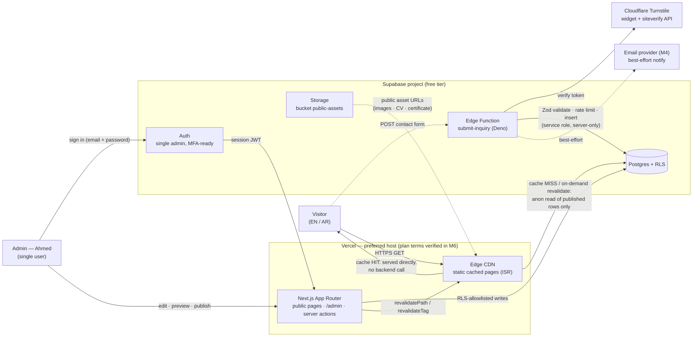

# ARCHITECTURE — System Architecture (`fotedev.me`)

**Status:** Spec for Milestones 1–6. This document is the architecture contract for the implementation milestones; the schema it references is defined in `docs/CONTENT-MODEL.md`.
**Sources of truth:** `prompt-0.md` §2 (locked decisions), `prompt-1.md` §5.3 (content requirements), `docs/CONTENT-MODEL.md` (tables + RLS intent), `docs/decisions/ADR-*` (decision records once created).
**Hard rule:** Nothing here re-litigates a locked decision. Where this document and `prompt-0.md` §2 disagree, `prompt-0.md` §2 wins and this document must be corrected.

---

## Table of contents

1. [Purpose & scope](#1-purpose--scope)
2. [System context](#2-system-context)
3. [Publish flow](#3-publish-flow-admin-draft--preview--publish--revalidation)
4. [Contact flow](#4-contact-flow-submit--validate--rate-limit--insert--notify)
5. [ISR & caching strategy](#5-isr--caching-strategy)
6. [Supabase topology](#6-supabase-topology)
7. [Free tier & quota plan](#7-free-tier--quota-plan-required)
8. [Security architecture](#8-security-architecture)
9. [Hosting: Vercel & fallbacks](#9-hosting-vercel--fallbacks)
10. [Source layout preview (`src/`)](#10-source-layout-preview-src)
11. [Decision records & open items](#11-decision-records--open-items)

---

## 1. Purpose & scope

A two-sided system on free tiers:

- **Public portfolio** (`/en`, `/ar`): static, cached, fast. Visitors never touch Supabase in the hot path. The single conversion goal is a qualified inquiry via the contact form.
- **Admin CMS** (`/admin`): one authenticated user (Ahmed). Structured editing only — no page builder, no roles, no client accounts. Publishing triggers **targeted on-demand revalidation** of the affected public routes.

Explicit non-goals (locked): no blog UI, no store, no client login, no booking, no testimonials, no multi-admin.

Key architectural property to preserve everywhere: **writes fail closed; the public site stays cached and readable.** Supabase is allowed to be down without taking the public site down, because visitors are served from Vercel's cache.

---

## 2. System context

All diagrams in this document are inline Mermaid — no standalone HTML.



Reading of the diagram:

1. **Visitor → Vercel → (cache):** public pages are static and served from the Vercel Edge cache. A cache hit makes **zero** Supabase calls — this is the locked "near-zero Supabase reads for visitors" property.
2. **Vercel → Supabase (reads only on publish/revalidate):** Supabase is read (a) at build time and (b) when a route is revalidated on demand. Both use the **anon key**, and RLS guarantees only `published` rows can enter the public cache. Draft content can therefore never leak into a public page.
3. **Admin → Supabase Auth → Admin app → Supabase writes → revalidate:** Ahmed signs in via Supabase Auth; the admin app (Next.js server actions) writes through an RLS-allowlisted session, then calls `revalidatePath` / `revalidateTag` on Vercel. Revalidation failure is surfaced to the admin — success is never faked (GATE rule, `prompt-0.md` §3.10).
4. **Contact path bypasses the site runtime entirely:** the form posts to a Supabase Edge Function, so contact traffic does not consume Vercel serverless invocations in the request path, and the email/notification concern lives outside the web app.

---

## 3. Publish flow (admin draft → preview → publish → revalidation)

```mermaid
sequenceDiagram
    autonumber
    actor A as Admin (Ahmed)
    participant App as /admin app (Next.js server actions)
    participant DB as Supabase Postgres (RLS)
    participant ISR as Vercel ISR / Edge cache
    participant Pub as Public pages (/en · /ar)

    A->>App: create / edit content (draft)
    App->>DB: save draft (Zod-validated, RLS-allowlisted session)
    DB-->>App: stored (status = draft)
    A->>App: request preview
    App->>DB: read draft by id (admin session)
    App-->>A: auth-gated preview (noindex, never cached)
    Note over A,App: preview requires a valid admin session;<br/>unauthenticated request gets redirect / 404 — drafts are never publicly cached
    A->>App: Publish
    App->>App: publish gate (R3: AR translation exists, or en_only flag)
    App->>DB: UPDATE status = published · set published_at on first publish
    DB-->>App: commit confirmed
    App->>ISR: revalidatePath(public routes) + revalidateTag(tags)
    ISR-->>App: revalidation acknowledged
    Note over App,ISR: if revalidation fails, the admin UI shows the error.<br/>Publish is NOT reported successful unless both the write and the revalidation succeeded.
    A->>Pub: open public page
    Pub->>ISR: request (cache miss — tag invalidated)
    ISR->>DB: regenerate from published rows (anon read)
    ISR-->>Pub: fresh page, re-cached
    Pub-->>A: updated content visible
```

Failure semantics (non-negotiable):

- The publish UI distinguishes **three** outcomes: draft saved, published (write OK + revalidation OK), and **failed** (either step). A failed revalidation is reported as failure even if the DB write succeeded — the admin retries revalidation from `/admin`; the public site meanwhile keeps serving the previous cached version (stale but correct, never broken).
- Slug changes after publish follow R6: unpublish → change → `slug_redirects` row → publish → 301 from the old slug. See `docs/CONTENT-MODEL.md` §9 R6.

---

## 4. Contact flow (submit → validate → rate limit → insert → notify)

```mermaid
sequenceDiagram
    autonumber
    actor U as Visitor
    participant Form as Contact form (client component)
    participant EF as Edge Function submit-inquiry (Deno)
    participant TS as Turnstile siteverify API
    participant DB as Supabase Postgres (service role)
    participant Email as Email provider (chosen in M4)

    U->>Form: fill name / email / message (+ optional service, budget, timeline)
    Form->>Form: Turnstile widget issues token · honeypot field filled invisibly
    Form->>EF: POST /functions/v1/submit-inquiry (payload + client idempotency token)
    EF->>EF: honeypot check — hit ⇒ silent drop + honeypot counter (no error to bot)
    EF->>EF: Zod validation: lengths, email format, payload size cap,<br/>attachments/oversized payloads rejected outright
    EF->>TS: POST siteverify (token + transient IP, in-memory only)
    TS-->>EF: success / failure (failure, timeout, or 5xx after the 5 s cap ⇒ reject, fail closed with a user-facing retry message)
    EF->>DB: check_and_increment_rate_limit(net:<ip_hash> · email:<email> · global:daily)
    DB-->>EF: allow / block (block ⇒ 429, rate-limit message + direct email fallback shown)
    EF->>DB: INSERT inquiries (ip_hash = salted SHA-256, unique submission_token)
    DB-->>EF: inserted row (storage result)
    Note over EF,Email: notification email is best-effort: timeout-bounded;<br/>failure is logged and NEVER blocks the success response
    EF--x Email: attempt notification send
    EF-->>Form: 200 { ok: true, inquiryId }
    Form-->>U: success state rendered from the storage result ·<br/>direct copyable email fallback always visible
```

Flow rules:

1. **Success is defined by the storage insert, not by email delivery.** The locked decision "success shown from storage result" means the UI never claims or denies success based on the email provider's state.
2. **Idempotency:** the client generates a `submission_token`; a retry with the same token that finds an existing row returns the same success response (double-submit dedupe). Tokens are single-use and unique. A concurrent duplicate POST with the same `submission_token` hits the unique constraint; the function catches the conflict and returns the same idempotent success (dedupe) — never a 500.
3. **Persistent rate limiting** lives in Postgres (`rate_limit_counters`), not in memory, so it survives function restarts and cold starts. Starting limits (admin-configurable): 3 per 10 minutes per network-identifier hash, 5 per email per day, 50 global per day (per `docs/CONTENT-MODEL.md` §7.3). `check_and_increment_rate_limit` must be atomic (a single SQL statement or transaction) so parallel calls cannot race the counter. If a counter is corrupt or the window resets, the limiter **fails closed** (rejects), never open.
4. **Prompt-injection guard:** inquiry `message` content is treated strictly as data — stored verbatim, displayed in the admin inbox, never executed, never summarized by an unsupervised agent. The same untrusted-data rule applies to the notification email: inquiry fields rendered into it are plain-text only, escaped, no HTML interpolation.
5. **No raw IPs, no user agents, no attachments** are ever stored (see §8 and `docs/CONTENT-MODEL.md` §7.2).
6. **Siteverify is timeout-bounded (5 s):** the Turnstile siteverify fetch is capped at 5 s; on timeout or 5xx the submission is rejected fail-closed with a user-facing retry message.
7. **Turnstile tokens are single-use:** after any failed attempt (429, 5xx, siteverify failure), the client must reset the Turnstile widget and obtain a fresh token before retry — a consumed token cannot be reused.

---

## 5. ISR & caching strategy

### 5.1 Principles

- **Static generation first.** Every public route is pre-rendered at build time from published Supabase rows (anon client; RLS restricts reads to published content). `revalidate = false` — pages change **only** via on-demand invalidation from `/admin`, never on a timer.
- **Tag-based invalidation per route.** A single source-of-truth tag registry (`src/lib/cache/tags.ts`) maps writes to tags. Admin server actions call `revalidateTag(...)` for the tags the write affects (plus `revalidatePath` for the exact locale paths when narrower control is needed).
- **Drafts are never cached.** The admin preview renders draft data only inside an authenticated, noindexed route with `dynamic = 'force-dynamic'` and no caching headers. Nothing from a draft can enter the public cache.
- **Build-time reads use the anon key.** The service-role key never participates in public page rendering (§8).

### 5.2 Tag map

| Route (both locales) | Tags | Invalidated when |
|---|---|---|
| `/[locale]` (home) | `home`, `projects:list`, `settings` | any project publish/unpublish/feature/sort change; settings change |
| `/[locale]/projects` | `projects:list`, `settings` | any project write |
| `/[locale]/projects/[slug]` | `project:{slug}`, `projects:list` | that project's write; slug change → 301 via `slug_redirects` + list revalidation |
| `/[locale]/services` | `services` | any service write |
| `/[locale]/about` | `credentials`, `contributions`, `settings` | credential/contribution write; settings change |
| `/[locale]/contact` | `settings` | contact email / availability change |

### 5.3 Publish latency target

- **Gate: a successful publish is visible on the affected public route with p95 ≤ 60 s measured in M5 (gating); ≤ 5 s is a non-gating aspiration.**
- Measured in **M5** with real publishes (project, service, settings) on a Vercel preview deployment; results recorded in `.factory/RUN_LOG.md`. If the 60 s gate is missed, the architecture issue is fixed before GATE 2 — latency is not accepted as-is.
- Expected behavior on Vercel: on-demand tag revalidation is typically sub-second; the 5 s aspiration covers cold regeneration. The number is a **test target**, not an assumed platform constant.

---

## 6. Supabase topology

One Supabase project (new org, created via Supabase MCP in M1), four capabilities:

| Capability | Role in this system | Notes |
|---|---|---|
| **Postgres + RLS** | All content tables, `inquiries`, `rate_limit_counters`, `slug_redirects` | RLS enabled on **every** table; the full anon/service/admin policy matrix is `docs/CONTENT-MODEL.md` §8 and is proven in M1 with `supabase/tests/rls_verification.sql`. Anonymous users have no write access to anything. |
| **Auth** | Sign-in for the single admin (Ahmed); **MFA-ready** | Admin identity allowlist (`admin_users` table vs `auth.uid()` constant) decided as ADR-0007 in M1. MFA-ready; enabling before launch is recommended and documented in `docs/OPERATIONS.md` §9, but it is not a CI gate. The admin route guard must not assume single-factor — enabling MFA must be a settings change, not a refactor. Session expiry mid-edit is guarded (unsaved-changes warning). |
| **Storage — bucket `public-assets`** | Images (project covers/gallery), CV PDF, certificate PDF | Upload limits enforced at upload time: images ≤ 2 MB, PDFs ≤ 10 MB; MIME whitelist (image types + `application/pdf`); executables/HTML rejected. Declared Content-Type alone is insufficient — uploads require content-based validation (magic-byte check) or restrictive serving headers (`X-Content-Type-Options: nosniff`, `Content-Disposition: attachment` for PDFs); executables/HTML are never served inline. Every object is registered in `media_assets` with `alt_en` + `alt_ar` (DB-enforced, R4). Bucket policies: public read of whitelisted types, writes admin-only. Fallback if the certificate upload fails in M1: `public/certificates/` in the repo, flagged at the gate. |
| **Edge Functions (Deno)** | `submit-inquiry` (M4) — the only v1 function | Holds the secret-bearing steps: Turnstile siteverify, rate-limit checks, service-role insert, best-effort email. Zod schemas are shared with the app (same validation package) so client, server, and function validate identically. |

Environment variables follow `docs/OPERATIONS.md`: `NEXT_PUBLIC_SUPABASE_URL` + `NEXT_PUBLIC_SUPABASE_ANON_KEY` (browser-safe), `SUPABASE_SERVICE_ROLE_KEY` (server/Edge only, never `NEXT_PUBLIC_`), `TURNSTILE_SECRET_KEY` (Edge only), `IP_HASH_SALT` (server only).

---

## 7. Free tier & quota plan (REQUIRED)

The system must run on free tiers indefinitely, or fail visibly rather than silently. This section states the assumptions, the budgets, and the behavior when a limit is hit. **Exact numeric platform limits are not guessed here — every cell marked `TO CAPTURE` is filled in M1 (and M4 for the email provider) with the value, the source URL, and the capture date, recorded in `docs/OPERATIONS.md` quota table and re-checked monthly.**

### 7.1 Expected traffic assumptions (planning assumptions, not guarantees)

| Dimension | Assumption at launch |
|---|---|
| Public page views | Low thousands per month (freelance portfolio, EN/AR) |
| Contact submissions | ≤ ~100/month (drives function invocations: 1 invocation per submission attempt) |
| Publishes | ≤ ~10/week (each = a handful of Edge/serverless invocations for revalidation) |
| Admin usage | 1 user, short sessions |
| Static assets | A handful of images + 2 PDFs (certificate, CV when verified) |

### 7.2 Budgets

| Budget | Driver | Planning posture |
|---|---|---|
| **Function invocations** | `submit-inquiry` (1 per submission attempt, including rejected ones) + revalidation-time serverless work | Rejections (honeypot, rate limit, validation fail) still count as invocations — budget at worst-case submission volume, not accepted volume. Value cap: `TO CAPTURE IN M1 (record with source URL + date)`. |
| **Storage** | `public-assets` objects + Supabase Postgres row storage | Enforced additionally by app-level upload limits (images ≤ 2 MB, PDFs ≤ 10 MB) so we stay well inside the platform cap. Caps: `TO CAPTURE IN M1 (record with source URL + date)`. |
| **Egress / bandwidth** | Vercel bandwidth (public pages) + Supabase egress (revalidation reads, Storage object fetches) | Public traffic is CDN-served; Supabase egress is only revalidation reads and Storage pulls. Caps: `TO CAPTURE IN M1 (record with source URL + date)` for both Vercel and Supabase. |
| **Database rows** | `inquiries` + `rate_limit_counters` | Bounded by retention (§7.3) and fixed-window counter purge (>2 days old); row counts stay small and predictable. |
| **Email sends** | 1 notification per accepted inquiry | Provider chosen in M4 after a current pricing check; its free-tier sending cap: `TO CAPTURE IN M4 (record with source URL + date)`. |
| **Turnstile** | 1 widget challenge per form view; 1 siteverify per submission | Free-tier request limits: `TO CAPTURE IN M1 (record with source URL + date)`. |

### 7.3 Data retention

- **Inquiries: 24 months, then purged.** The retention policy is documented from M1; the purge script itself is delivered in M4 (when inquiries start flowing) and is run manually or scheduled per `docs/OPERATIONS.md`; purging deletes the rows, not just flags them.
- **Delete-on-request honored:** any inquiry is deletable from `/admin` on request (and by direct SQL if the admin is locked out); deletion is immediate and confirmed. No soft-delete copies of inquiry rows are kept beyond the 24-month window.
- **Rate-limit counters** older than ~2 days are purgeable garbage.
- **Media assets** are kept while referenced by published content; removal is an admin decision, not automatic.

### 7.4 Global caps

| Cap | Value | Action |
|---|---|---|
| Supabase database size | `TO CAPTURE IN M1 (record with source URL + date)` | Monthly checklist check |
| Supabase storage size | `TO CAPTURE IN M1 (record with source URL + date)` | Monthly checklist check |
| Supabase egress | `TO CAPTURE IN M1 (record with source URL + date)` | Monthly checklist check |
| Supabase Edge Function invocations | `TO CAPTURE IN M1 (record with source URL + date)` | Monthly checklist check |
| Vercel bandwidth / ISR & function invocations / Edge requests | `TO CAPTURE IN M1 (record with source URL + date)` | Monthly checklist check; M6 additionally verifies plan **terms**, not just numbers |
| Turnstile free-tier limits | `TO CAPTURE IN M1 (record with source URL + date)` | Monthly checklist check |
| Email provider sending limits | `TO CAPTURE IN M4 (record with source URL + date)` | Chosen with provider selection in M4 |

### 7.5 Behavior when quotas/limits are reached

The invariant, from the locked decisions and R12 in `docs/CONTENT-MODEL.md`: **writes fail closed; public pages stay cached and readable.**

| Failure | Behavior |
|---|---|
| Supabase DB write failure (size cap, connection limit, function error) | Contact form returns an explicit error; the **direct copyable email fallback is always visible** so the conversion path never dies. Admin sees the write failure. Public pages are unaffected — they are cached. |
| Edge Function invocation cap reached | Form submissions fail with an explicit error + email fallback. Public pages unaffected. |
| Rate-limit counters unreachable/corrupt | Limiter fails **closed** (rejects); the visitor sees the rate-limit message + email fallback. Never fails open. |
| Storage cap reached / upload rejected | New uploads rejected in `/admin` with a clear message; the live site keeps serving existing assets from cache. |
| Email provider cap / outage | Notification skipped and **logged**; the inquiry is still stored; the form still succeeds (success = storage result). |
| Vercel bandwidth / revalidation quota hit | Existing cached pages keep serving. A publish whose revalidation fails is reported as failed in `/admin` (never faked success); the admin retries later. No silent stale-forever — the admin is the one who sees staleness. |
| Quota exhaustion is **never** hidden | Monthly quota checklist (`docs/OPERATIONS.md`) compares captured caps vs. dashboard usage; a projected breach is an explicit GATE 2 blocker, not a runtime surprise. |

---

## 8. Security architecture

| Control | Rule |
|---|---|
| **RLS everywhere** | RLS enabled on every table, with the anon/service/admin matrix from `docs/CONTENT-MODEL.md` §8. Proven in M1 by `supabase/tests/rls_verification.sql` against anon and admin sessions. No table ships without policies. |
| **Service-role key is server-only** | `SUPABASE_SERVICE_ROLE_KEY` exists only in Edge Function secrets and server-only env, never in `NEXT_PUBLIC_*`, never imported into client code, never logged. The anon key is the only client-side Supabase credential, and RLS is what makes that safe. |
| **`ip_hash`, never raw IPs** | The visitor IP is hashed with **salted SHA-256** (salt in server env, 64-hex-char column check). The raw IP exists transiently in memory only (for the optional Turnstile `remoteip` field and the hash) and is **never persisted** in the DB, logs, or analytics. No `ip` or `user_agent` columns exist. |
| **No anonymous inserts** | Anonymous users can never insert into `inquiries` (or any table) — RLS denies it; the only write path is the Edge Function with the service role after Turnstile + rate limit. This is a locked decision, verified by SQL in M1. |
| **Admin routes: noindex + auth** | `/admin` and all admin/preview routes are excluded in `robots.txt`, carry `noindex` robots meta, and are auth-gated server-side (session check in the admin layout + per-action guard). Preview routes for drafts are additionally uncached and force-dynamic. Session expiry mid-edit shows an unsaved-changes guard. |
| **CSP-compatible headers** | Security headers (`Content-Security-Policy`, `X-Content-Type-Options`, `Referrer-Policy`, `Permissions-Policy`) are defined in `next.config` headers so they work on Vercel and are portable to the fallback hosts. CSP must remain compatible with: (a) the blocking inline theme-init script — handled via a hash/nonce, not blanket `unsafe-inline` where avoidable; (b) the Turnstile widget — `frame-src https://challenges.cloudflare.com` and its script origin; (c) Next.js hydration scripts. The exact CSP is finalized in M2 and must not break EN/AR public pages or the admin. **Development exception:** `next dev` adds `'unsafe-eval'` (React dev-mode call-stack reconstruction) and `ws:` (Turbopack HMR) to the policy; `next build`/`next start` and Vercel never include them. |
| **Prompt-injection containment** | Inquiry `message` is data. It is stored verbatim and rendered as text (escaped) in the admin inbox. No agent summarizes or acts on inquiry content unsupervised. |
| **No secrets in repo** | `.env.example` only; `.env.local` gitignored; Edge Function secrets managed in Supabase; CI never needs production secrets. |

---

## 9. Hosting: Vercel & fallbacks

- **Vercel is the preferred host** (locked): ISR + on-demand revalidation, Edge network, Vercel Analytics + Speed Insights, zero-config Next.js.
- **M6 gate (hard requirement):** before launch, M6 must verify that the **current** Vercel plan terms permit this intended use. The Hobby plan is restricted to **non-commercial** use; this site exists to generate freelance inquiries, which is a commercial purpose. If the terms do not permit it: **STOP and report options** (upgrade / Netlify / Cloudflare Pages) — do not deploy "to see". This check is against the plan terms live at M6 time, not remembered text.
- **Fallback hosts (documented, not implemented in v1):** **Netlify** and **Cloudflare Pages** free tiers permit commercial use. Architecture impact if used: Next.js on-demand revalidation is supported via their Next.js runtimes/adapters (Netlify: on-demand builders/revalidation support; Cloudflare: `@cloudflare/next-on-pages` — verify ISR parity at migration time, it is a known soft spot). The CSP/headers approach (§8) and the Supabase/Turnstile/Edge Function topology are host-agnostic and unchanged. Migration cost is limited to hosting config + revalidation parity testing; the contact path (Edge Functions) is unaffected.
- **DNS:** `fotedev.me` points at the chosen host; domain setup is M6 work.

---

## 10. Source layout preview (`src/`)

Locked stack: **Next.js App Router + TypeScript strict (zero `any`) + Tailwind CSS + shadcn/ui + Framer Motion + next-intl (EN default + AR RTL)**. This is the target layout the milestones build toward; milestones may add files but must not restructure these top-level concerns.

```
src/
├── app/
│   ├── [locale]/                  # public, i18n-routed, statically generated
│   │   ├── layout.tsx             # locale shell: lang/dir, theme init (zero-FOUC), header/footer
│   │   ├── page.tsx               # Home — hero, selected work, services teaser, credibility
│   │   ├── projects/
│   │   │   ├── page.tsx           # Projects index (generateStaticParams + tags)
│   │   │   └── [slug]/page.tsx    # Case study
│   │   ├── services/page.tsx
│   │   ├── about/page.tsx         # About + credentials (OMP certificate)
│   │   └── contact/page.tsx       # Contact form (client island: Turnstile + honeypot)
│   ├── admin/                     # English-only UI, noindex, auth-gated (outside [locale])
│   │   ├── layout.tsx             # session guard + noindex meta
│   │   ├── login/page.tsx
│   │   ├── page.tsx               # dashboard (inquiries inbox entry)
│   │   ├── projects/ · services/ · credentials/ · contributions/ · inquiries/ · media/ · settings/
│   │   └── actions.ts             # server actions: CRUD, publish gate, revalidation calls
│   └── api/                       # thin BFF only if a route is required;
│                                   # primary server logic = server actions + Edge Functions
├── components/
│   ├── ui/                        # shadcn/ui primitives (theme-token driven)
│   ├── layout/                    # header, footer, nav, locale switcher, theme toggle
│   ├── sections/                  # hero, work grid, services, credibility, about preview
│   ├── forms/                     # contact form, Turnstile wrapper, inline-error fields
│   └── motion/                    # Framer Motion wrappers (reduced-motion aware, ≤200ms)
├── lib/
│   ├── supabase/                  # browser client (anon) · server client (anon) ·
│   │                              # admin client (service role — server-only import)
│   ├── cache/tags.ts              # revalidation tag registry (§5.2 map)
│   ├── validation/                # shared Zod schemas (client/server/Edge parity)
│   ├── i18n/                      # next-intl routing + request config, EN-fallback logic
│   ├── seo/                       # metadata builders, JSON-LD, sitemap helpers
│   └── email/                     # M4 provider adapter (best-effort send, timeout-bounded)
├── messages/                      # en.json · ar.json (native-quality AR, not flipped EN)
└── middleware.ts                  # next-intl locale routing (EN default, /en /ar paths)

supabase/                          # not src/ — owned by M1/M4
├── migrations/0001_initial_schema.sql
├── seed.sql
├── functions/submit-inquiry/      # Deno Edge Function (contact path)
└── tests/rls_verification.sql     # M1 RLS proof
```

Layout rules:

1. **Public pages never import the service-role client.** `lib/supabase/admin.ts` is import-restricted to server actions / server-only modules (enforced by review + lint in M2 CI).
2. **Admin lives outside `[locale]`** — single English admin UI; the public site is the only bilingual surface. Locked decision: docs, code comments, and admin are English only.
3. **Validation is written once** in `lib/validation/` and consumed by the form, the server actions, and the Edge Function, so the same Zod schema governs all three entry points.
4. **Theme/i18n/motion** follow `DESIGN.md` (tokens, RTL logical properties, reduced motion). Framer Motion is used only inside `components/motion/` wrappers so `prefers-reduced-motion` is enforced in one place.

---

## 11. Decision records & open items

| Item | Status |
|---|---|
| ADR-0001 stack (Next.js + Supabase) | Locked — `docs/decisions/ADR-0001-stack-next-supabase.md` |
| ADR-0002 hosting (Vercel, terms check) | Locked — `docs/decisions/ADR-0002-hosting-vercel-with-terms-check.md`; M6 executes the check |
| ADR-0003 license (AGPL-3.0-only + ARR assets) | Locked — `docs/decisions/ADR-0003-license-agpl-plus-all-rights-reserved.md` |
| ADR-0004 email-first contact, no booking | Locked — `docs/decisions/ADR-0004-email-first-contact-no-booking.md` |
| ADR-0005 single admin, no page builder | Locked — `docs/decisions/ADR-0005-single-admin-no-page-builder.md` |
| Admin identity mechanism (`admin_users` vs `auth.uid()`) | ADR-0007 in M1 |
| Email provider | Chosen in M4 after current pricing check |
| Quota numbers | `TO CAPTURE IN M1` / `TO CAPTURE IN M4` with source URL + date (§7.4) |
| Publish latency measurement | M5, recorded in `.factory/RUN_LOG.md` |
| Vercel plan-terms verification | M6 — hard gate before launch |
